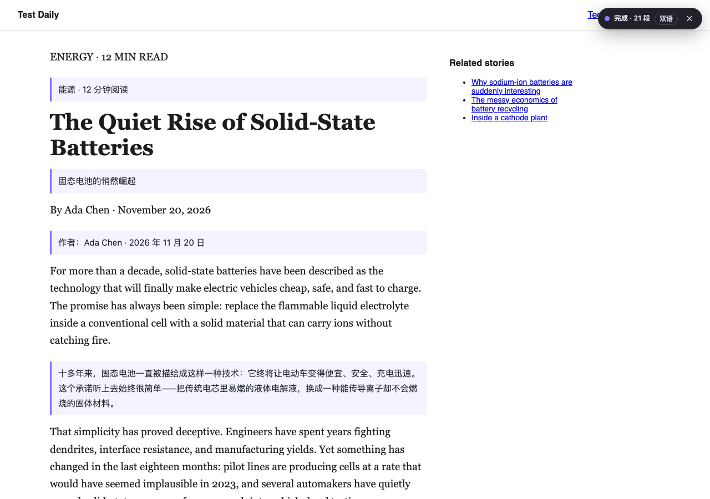
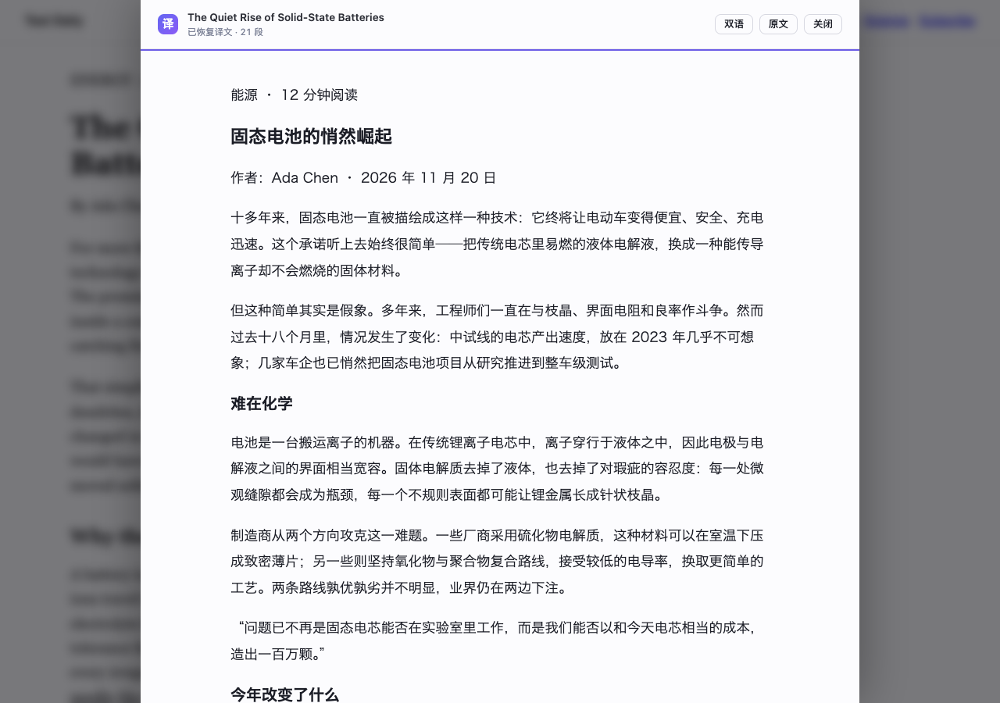
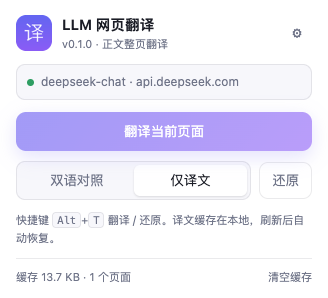

# LLM 网页翻译（Chrome 扩展）

提取网页正文，调用**任意 OpenAI 兼容 LLM** 一次性整页翻译。配置随 Chrome 账号同步，译文缓存在本地，刷新后自动恢复。



## 功能

- **正文提取**：启发式挑出主内容容器，过滤导航、广告、评论、侧栏、页脚和代码块。
- **一次性整页翻译**：按字符预算分批、并发请求；逐段对齐，模型少返/多返时自动拆分重试，不会把两段合并成一段。
- **任意 OpenAI 兼容接口**：OpenAI、DeepSeek、OpenRouter、Ollama、vLLM、LM Studio…只要实现 `/chat/completions`。
- **配置同步**：endpoint、模型、目标语言、提示词等写入 `chrome.storage.sync`，登录同一 Chrome 账号的设备自动同步。API Key 可选「仅本机保存」。
- **本地缓存**：
  - 段级缓存：同一段原文 + 同一模型 + 同一目标语言只翻一次；
  - 页面缓存：按 URL 记住整页译文，刷新后自动恢复，**不重新请求模型**；
  - 模型 / endpoint / 目标语言变化时，旧的页面缓存自动失效。
- **两种阅读方式**：双语对照（译文插在原文下方，不破坏页面 DOM 结构）或仅译文（独立沉浸式阅读器，可切回原文）。
- **三个入口**：工具栏 popup、快捷键 `Alt+T`、页面右键菜单。

| 仅译文阅读器 | popup |
| --- | --- |
|  |  |

## 安装（加载未打包扩展）

1. 克隆或下载本仓库。
2. 打开 `chrome://extensions`，右上角开启「开发者模式」。
3. 点击「加载已解压的扩展程序」，选择仓库根目录（含 `manifest.json` 的那一层）。
4. 建议把扩展固定到工具栏；首次安装会自动打开设置页。

> 仅支持 Chrome / Edge 等 Chromium 内核浏览器，`manifest_version: 3`，最低 Chrome 116。

## 配置

在设置页填写：

| 字段 | 说明 |
| --- | --- |
| Endpoint | 服务根地址，填到 `/v1` 即可，扩展自动补 `/chat/completions` |
| API Key | 本地模型可留空；默认随 Chrome 同步，可勾选「仅本机保存」 |
| 模型 ID | 服务端要求的模型名 |
| 目标语言 | 预设常用语言，也可自定义（如「粤语」「文言文」） |
| 额外请求头 / 参数 | JSON 对象，合并进请求头与请求体 |
| 每次字符上限 / 并发 / 超时 | 控制分批大小与吞吐 |
| 自定义 System Prompt | 留空使用内置提示词；支持 `{target}`、`{source}` 占位符 |

常见配置：

```text
OpenAI        endpoint  https://api.openai.com/v1        model  gpt-4o-mini
DeepSeek      endpoint  https://api.deepseek.com/v1      model  deepseek-chat
OpenRouter    endpoint  https://openrouter.ai/api/v1     model  openai/gpt-4o-mini
Ollama        endpoint  http://127.0.0.1:11434/v1        model  llama3.1:8b        （Key 留空）
LM Studio     endpoint  http://127.0.0.1:1234/v1         model  qwen2.5-7b-instruct
```

OpenRouter 建议加请求头：

```json
{ "HTTP-Referer": "https://your.site", "X-Title": "LLM Page Translator" }
```

保存后可点「测试连接」，会用一句 `Hello, world!` 走完整请求链路并显示耗时与译文。

### 同步与密钥

- 非敏感配置和（默认的）API Key 写在 `chrome.storage.sync`，跟随 Chrome 账号同步。
- Chrome 同步数据在服务端加密，但默认密钥也由 Google 管理；介意的话：
  1. 在 Chrome 设置里开启「同步密码短语」（端到端加密），或
  2. 在扩展设置里勾选「API Key 仅保存在本机」——Key 会改存 `chrome.storage.local`，不随账号离开这台设备。
- 译文、页面缓存始终只存在本机（`chrome.storage.local`），不会上传。

## 使用

1. 打开一篇文章，点击工具栏图标 →「翻译当前页面」，或按 `Alt+T`，或右键菜单。
2. 右上角状态条显示进度（如 `7/21`），完成后可：
   - 点「双语」在双语对照 / 仅译文之间切换；
   - 点 `✕` 停止并移除译文。
3. 「仅译文」阅读器里：`原文` 展开原文对照，`双语` 切回行内模式，`关闭` 或 `Esc` 退出。
4. 刷新页面会自动恢复缓存译文；想彻底移除，点 popup 里的「还原」。

一次翻译最多处理 500 段 / 8 万字符，超出会截断并提示。

## 缓存机制

```text
段缓存   seg:sha256(endpoint | model | targetLang | 原文)      -> { t: 译文, ts }
页面缓存 page:sha256(url) -> { signature: endpoint|model|lang,
                               entries: [[原文, 译文], ...], ts }
```

- 翻译时先查段缓存，命中直接渲染，只把未命中的段落发给模型。
- 任务结束后写页面缓存；刷新时 `tabs.onUpdated` 触发自动恢复，命中页面缓存就不再请求模型。
- 页面缓存最多保留 40 页 / 每页 24 万字符；段缓存总占用超过 40 MB 时按时间清理旧数据（最多每 6 小时检查一次）。
- 清空入口：popup 底部「清空缓存」或设置页「清空本地缓存」。

## 权限说明

| 权限 | 用途 |
| --- | --- |
| `storage` / `unlimitedStorage` | 同步配置、缓存译文 |
| `scripting` / `activeTab` / `tabs` | 在用户触发时注入正文提取与渲染脚本；刷新后判断 URL 并恢复 |
| `host_permissions: <all_urls>` | endpoint 由用户自定义，需要向任意域名发起请求；同时用于在普通网页注入内容脚本 |
| `contextMenus` | 右键菜单入口 |

扩展没有远程代码，所有逻辑都在仓库内；正文只发送到你自己配置的 LLM 服务。

## 目录结构

```text
manifest.json
src/
  background/
    service-worker.js   # 消息路由、注入、翻译任务、自动恢复、右键菜单
    llm.js              # OpenAI 兼容请求、JSON 解析、分批/重试（可在 Node 中测试）
    cache.js            # 段缓存 / 页面缓存 / 清理
  content/
    extract.js          # 正文提取（启发式打分）
    render.js           # 状态条 / 阅读器（shadow DOM）/ 行内译文
    main.js             # 内容脚本主流程（端口通信、增量渲染、缓存恢复）
    content.css         # 注入页面的译文块样式
  shared/config.js      # 配置默认值与 chrome.storage 读写
  popup/                # 工具栏弹窗
  options/              # 设置页
tests/
  unit.test.mjs         # 解析 / 分批 / 重试的单元测试
  e2e.mjs               # Playwright + 真实 Chromium + 假 LLM 的端到端测试
  screenshots.mjs       # 生成 README 截图
icons/                  # 16/32/48/128 图标
```

## 开发与测试

项目**没有构建步骤**：改完源码在 `chrome://extensions` 点「重新加载」即可；内容脚本会自动重新注入。

```bash
npm test          # 单元测试（node:test）
npm run check     # 所有 JS 语法 + JSON 校验
npm run test:e2e  # 端到端测试
node tests/screenshots.mjs   # 重新生成 docs/screenshots
```

端到端测试会启动真实 Chromium（加载本扩展）、本地静态文章页和假 LLM 服务，覆盖 17 项断言：设置保存、注入翻译、正文过滤、请求头 / 模型 / 目标语言、刷新自动恢复（零新增请求）、阅读器、错误 endpoint 报错、Key 本机分流、清空缓存后不再恢复。

Playwright 需要可加载扩展的 Chromium：

```bash
npx playwright install chromium
# 或指定已有二进制
CHROMIUM_PATH="/path/to/chrome" npm run test:e2e
```

> 注意：Chrome 137+ 的官方发行版移除了 `--load-extension` 命令行开关，端到端测试请用 Playwright 的 Chromium（Chrome for Testing）或 `channel: chromium`，不要用系统安装的 Google Chrome。

## 已知限制

- 只提取当前 DOM 中可见的正文块；无限滚动、懒加载内容需要滚动后再翻译。
- 不处理 iframe、跨域 shadow DOM、PDF 和图片内文字。
- 代码块（`<pre>`）跳过不翻；表格按单元格外的段落处理。
- 翻译质量取决于模型是否遵守「逐段 JSON 输出」；模型不遵守时会自动拆分重试，仍失败的段落会标红提示。
- 页面缓存按「原文文本」匹配：页面改版后，匹配不到的新段落不会恢复旧译文。
- 极长页面会截断到 500 段 / 8 万字符。
